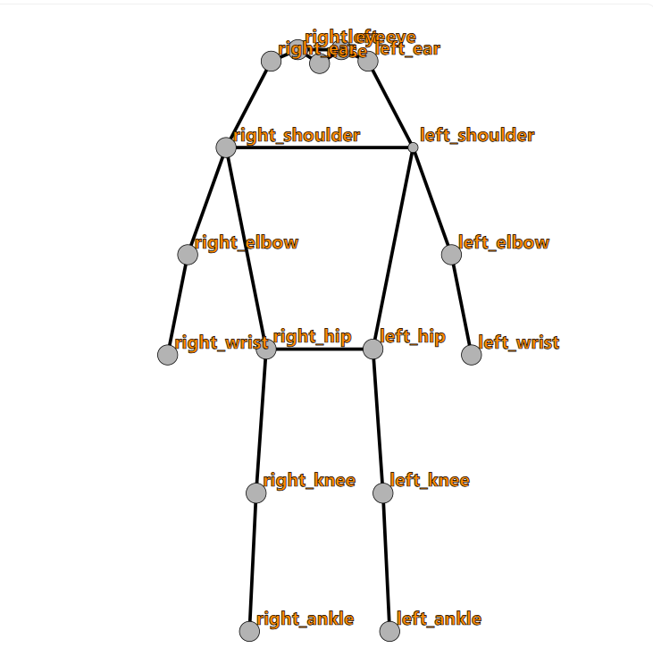
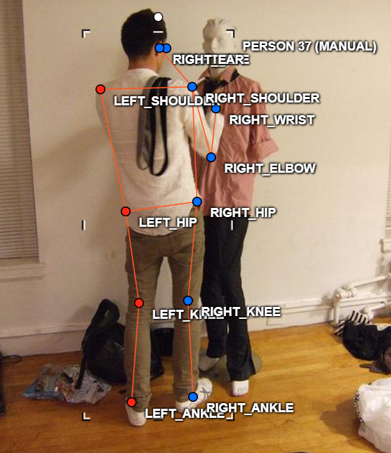
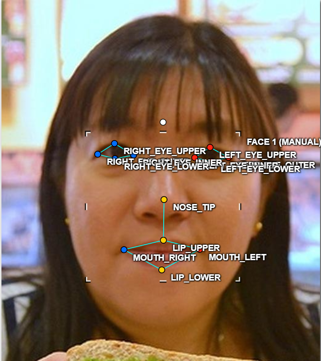
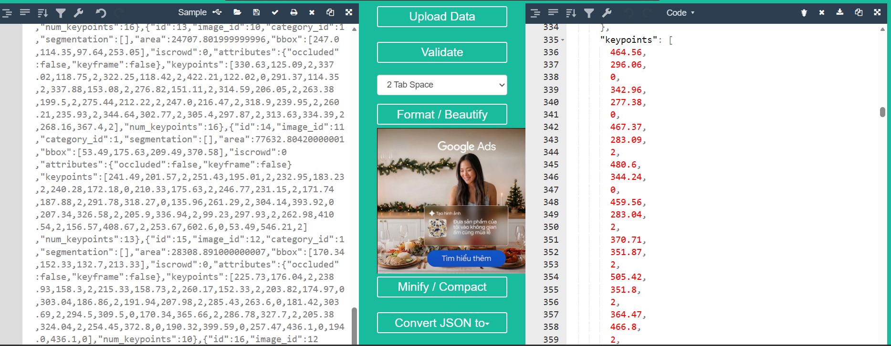

# Báo cáo cá nhân — VuThiNhung-2A202603156

Dữ liệu: 12 ảnh người COCO val2017 (Lin et al., 2014) và 8 ảnh chân dung Wikimedia Commons, chỉ dùng trong lớp.

## 0. Thông tin học viên

- Họ tên: Vũ Thị Nhung
- MSSV: 2A202603156
- Email: nhung0610@gmail.com
- Link repository: *(bạn cần điền link GitHub repo của bạn)*
- Phiên bản CVAT (Help → About): 2.74.1
- Máy: hệ điều hành Windows · RAM *(bạn cần điền)* GB · chạy CVAT chế độ đầy đủ
- Bộ ảnh (`src/exports/assignment.json` do `lab.py setup` tạo): có
- Giờ bắt đầu: *(bạn cần điền)*
- Giờ kết thúc: *(bạn cần điền)*

## 1. Kiểm tra label (CP0)

| Label | Kiểu | Số điểm | Tên điểm đúng bảng của lab? | Đúng thứ tự? | Số cạnh |
|---|---|---:|---|---|---:|
| `person` | Skeleton | 17 | Có | Có | 19 |
| `face` | Skeleton | 13 | Có | Có | 13 |

Mẫu `person` dựng theo người quay mặt về camera (các điểm `left_*` nằm bên phải khung mẫu)? Có

Cách đổi cờ `occluded` / `outside` cho **một điểm** trên phiên bản CVAT này (một câu):

Nhấp chuột phải vào điểm cần đổi, chọn `occluded` hoặc `outside` trong menu ngữ cảnh (hoặc chọn điểm rồi dùng phím tắt tương ứng trên thanh thuộc tính bên phải).

## 2. Số lượng đã gán và thời gian (CP1, CP2)

| Nhóm ảnh | Số ảnh | Số skeleton đã gán | Số người dưới 60 px (không gán) | Số poster / gương / màn hình bỏ qua | Thời gian (phút) |
|---|---:|---:|---:|---:|---:|
| `easy` | 5 | 5 | *(bạn cần điền)* | *(bạn cần điền)* | *(bạn cần điền)* |
| `occluded` | 3 | 5 | *(bạn cần điền)* | *(bạn cần điền)* | *(bạn cần điền)* |
| `back` | 2 | 3 | *(bạn cần điền)* | *(bạn cần điền)* | *(bạn cần điền)* |
| `small` | 1 | 1 | *(bạn cần điền)* | *(bạn cần điền)* | *(bạn cần điền)* |
| `crowd` | 1 | 2 | *(bạn cần điền)* | *(bạn cần điền)* | *(bạn cần điền)* |
| `faces` | 8 | 8 | — | *(bạn cần điền)* | *(bạn cần điền)* |

- Số ảnh người đã xong ở mốc phút 105: *(bạn cần điền)* / 10
- Thời gian thực tế (phút): CP1 *(bạn cần điền)* · CP2 *(bạn cần điền)* · CP3 *(bạn cần điền)*
- Ảnh tốn thời gian nhất là ảnh nào, vì sao?

*(bạn cần điền — ảnh nào tốn thời gian nhất, vì sao: nhiều người, nhiều điểm bị che, người quay lưng...)*

## 3. Bảng ca khó (CP1, CP2)

Mỗi điểm bạn phân vân một dòng, nhất là phân vân giữa `v = 1` và `v = 0`, hoặc không chắc hướng người.

| Ảnh | Người / mặt | Điểm | Cờ đã chọn | Phân vân giữa | Lý do chọn |
|---|---|---|---:|---|---|
| | | | | | |
| | | | | | |
| | | | | | |

## 4. Bảng tự review (CP3)

Đi từ ảnh cuối về ảnh đầu. 5 ảnh người (ít nhất 2 ảnh `back` hoặc `crowd`) và 3 ảnh mặt. Ít nhất 8 dòng, kể cả dòng `ok`. Ghi lỗi trước, sửa sau.

Mã lỗi dùng đúng một trong: `lr_swap`, `vis_flag`, `position`, `missing`, `extra`, `ok`.

| Ảnh | Người / mặt | Điểm | Mã lỗi | Ghi chú | Đã sửa? |
|---|---|---|---|---|---|
| | | | | | |
| | | | | | |
| | | | | | |
| | | | | | |
| | | | | | |
| | | | | | |
| | | | | | |
| | | | | | |

Tổng hợp số lỗi theo mã:

| `lr_swap` | `vis_flag` | `position` | `missing` | `extra` | `ok` |
|---:|---:|---:|---:|---:|---:|
| | | | | | |

Điểm còn phân vân giữa `v = 1` và `v = 0` (ghi cả hai lựa chọn và lý do chọn):

...

## 5. Kiểm file xuất và kết quả tự kiểm (CP4)

Tự kiểm tay trong file JSON:

| File | Người / mặt kiểm (ảnh, thứ tự) | Số phần tử `keypoints` | Điểm `outside` ra `v = 0`, `occluded` ra `v = 1`? | `num_keypoints` khớp? |
|---|---|---:|---|---|
| `VuThiNhung_persons.zip` | 000000043719.jpg, #1 | 51 | Có (v=0: nose, left_eye, left_ear, left_wrist, right_wrist, left_ankle, right_ankle) | Có (num_keypoints = 10, count v>0 = 10) |
| `VuThiNhung_persons.zip` | 000000043968.jpg, #2 | 51 | Có (v=0: left_ear, right_ear, left_hip) | Có (num_keypoints = 14, count v>0 = 14) |
| `VuThiNhung_faces.zip` | face_204787.jpg, #1 | 39 | Có (không có điểm outside hay occluded) | Có (num_keypoints = 13, count v>0 = 13) |

Sau khi xuất, CVAT ghi `occluded` thành `v = 1` và `outside` thành `v = 0`. Tọa độ của điểm `outside` trong file là tọa độ cũ (CVAT 2.x vẫn ghi tọa độ cũ, chuẩn COCO ghi 0, 0).

Hai job đã chuyển sang completed trên CVAT? *(bạn cần chuyển sang completed rồi điền Có)*

Dán phần **TÓM TẮT** in ra từ `src/check_submission.py`:

```text
- File person: VuThiNhung_persons.zip
  Số ảnh: 12 · số skeleton `person`: 16 · mỗi annotation 51 số
  Skeleton theo ảnh: 000000043719=1, 000000043968=1, 000000090646=1, 000000100510=1, 000000109010=2, 000000130816=2, 000000210604=2, 000000213933=1, 000000292999=1, 000000390585=1, 000000431893=1, 000000467300=2
  Cờ v: v=2 206 (76%) · v=1 0 (0%) · v=0 66 (24%)
  num_keypoints trung bình: 12.9
- File face: VuThiNhung_faces.zip
  Số ảnh: 8 · số skeleton `face`: 8 · mỗi annotation 39 số
  Skeleton theo ảnh: face_204787=1, face_261458=1, face_309728=1, face_345145=1, face_476363=1, face_490361=1, face_79591=1, face_92028=1
  Cờ v: v=2 94 (90%) · v=1 10 (10%) · v=0 0 (0%)
  num_keypoints trung bình: 13.0
- Ghi chú: 66 điểm v = 0 vẫn mang tọa độ cũ (CVAT 2.x xuất như vậy; chuẩn COCO ghi 0, 0). Không phải lỗi: điểm v = 0 bị bỏ qua khi huấn luyện và khi chấm.
- Số [LỖI]: 0 · số [CẢNH BÁO]: 2
Kết quả: ĐẠT (đọc lại từng cảnh báo ở trên)
```

Các `[CẢNH BÁO]` còn giữ nguyên và lý do:

1. `000000043968.jpg #1: cặp knee, ankle nằm ngược phía so với các cặp còn lại` — *(bạn cần điền: nếu đã kiểm lại và xác nhận đúng, ghi lý do, ví dụ: "Đã kiểm lại, người ngồi bắt chéo chân nên knee/ankle nằm ngược phía là đúng" hoặc nếu đúng là lr_swap thì cần sửa trên CVAT)*
2. `000000292999.jpg #1: cặp elbow nằm ngược phía so với các cặp còn lại` — *(bạn cần điền: tương tự, kiểm lại và ghi lý do)*

## 6. Ảnh chụp màn hình

1. Label `person` trong label constructor (đủ 17 điểm có tên):

   

2. Một người quay lưng đã gán, cờ đã đặt:

   

3. Một khuôn mặt đã gán 13 điểm, phóng to vùng mắt:

   

4. Một đoạn JSON xuất của một người:

   

Nguồn ảnh: COCO val2017 / Wikimedia Commons.

## 7. Tự đánh giá

1. Lỗi bạn mắc nhiều nhất hôm nay, và cách bạn sẽ tránh ở dự án thật:

   ...

2. Một quy tắc bạn đề xuất thêm vào guideline (kèm ảnh ví dụ nếu có):

   ...

3. Nhãn của bạn đi vào model ở đâu? Chọn một lỗi bạn đã sửa và nói nó sẽ làm model học sai thế nào (heatmap, trọng số trong loss, hay bước lật ảnh):

   ...

## 8. Khó khăn và lỗi kỹ thuật

...

## Bonus (nếu làm)

### B1 — 3 ảnh người khó thêm

| Ảnh | Số skeleton | Số người dưới 60 px | Ca khó nhất |
|---|---:|---:|---|
| | | | |
| | | | |
| | | | |

Kết quả `src/check_submission.py` cho `HoVaTen_bonus_persons.zip`:

```text
(dán ở đây)
```

### B2 — 5 ảnh khuôn mặt đen trắng / hồng ngoại

Ảnh không màu khó hơn ở điểm nào? Kính râm trên ảnh hồng ngoại có còn là `v = 1` không?

...

### B3 — Model so với nhãn của tôi (không tính điểm)

- Demo đã dùng:
- Ảnh đã thử:

1. Model có trả điểm cho khớp bị che, hay khớp ngoài ảnh không? Confidence ở các điểm đó thế nào?

   ...

2. Với người quay lưng, model có đổi trái/phải không?

   ...

3. Bộ điểm của model có giống 17 điểm COCO không?

   ...

## 9. Tài liệu tham khảo và công cụ AI đã dùng

- Antigravity (AI assistant): hỗ trợ điền báo cáo, giải thích kết quả script tự kiểm, tra cứu cấu trúc file COCO Keypoints.
